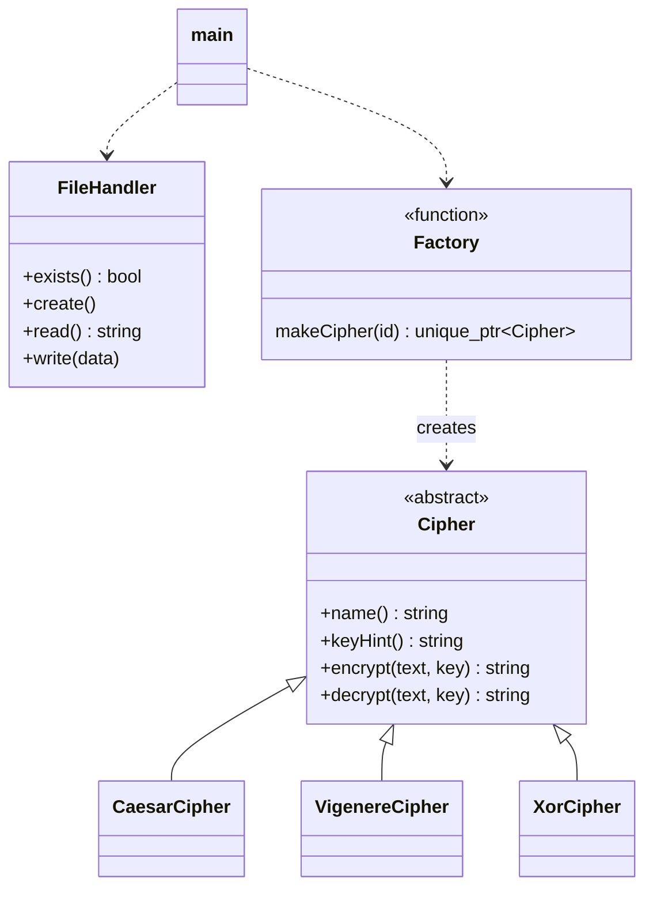

<div align="center">

```
 _____ _ _       ____                  _
|  ___(_) | ___ / ___|_ __ _   _ _ __ | |_
| |_  | | |/ _ \ |   | '__| | | | '_ \| __|
|  _| | | |  __/ |___| |  | |_| | |_) | |_
|_|   |_|_|\___|\____|_|   \__, | .__/ \__|
                           |___/|_|
```

### 🔐 A fast, object-oriented file encryption toolkit written in modern C++17


**Caesar · Vigenère · XOR** &nbsp;|&nbsp; interactive menu **or** scriptable CLI &nbsp;|&nbsp; zero dependencies

</div>

---

## ✨ Features

| | |
|---|---|
| 🧱 **Clean OOP design** | Abstract `Cipher` base class, three derived ciphers, a factory and a file handler, all using polymorphism |
| 🔑 **Three ciphers** | Caesar (integer shift), Vigenère (keyword), repeating-key XOR (hex output) |
| 🖥️ **Two interfaces** | Guided interactive menu, or flags for scripts and pipelines |
| 🛡️ **Robust errors** | Bad keys, missing files and corrupt ciphertext give clear messages, not crashes |
| 🧪 **Tested** | Dependency-free unit tests wired into CMake/CTest and GitHub Actions CI |
| 📦 **Zero dependencies** | Just a C++17 compiler |

---

## 🚀 Quick start

```bash
git clone https://github.com/<your-username>/filecrypt.git
cd filecrypt
make            # builds ./build/filecrypt
make test       # runs the unit tests
make demo       # encrypts + decrypts examples/sample.txt
```

Prefer CMake?

```bash
cmake -S . -B build
cmake --build build
ctest --test-dir build --output-on-failure
```

> Requires **g++ ≥ 7**, **clang ≥ 5** or **MSVC 2017+** (anything with C++17).

---

## 🕹️ Usage

### Interactive mode

Run it with no arguments and follow the prompts:

```bash
./build/filecrypt
```

```
Input file path : examples/sample.txt

  [1] Encrypt
  [2] Decrypt
Choose mode    : 1

  [1] Caesar
  [2] Vigenere
  [3] XOR
Choose cipher  : 2
Key (a keyword made of letters, e.g. LEMON) : LEMON
Output file path: secret.txt

[ok] Vigenere Cipher - encrypted 96 bytes read -> secret.txt
```

### Command-line mode

```bash
./build/filecrypt -m <encrypt|decrypt> -c <caesar|vigenere|xor> -k <key> -i <in> -o <out>
```

| Flag | Meaning |
|------|---------|
| `-m, --mode` | `encrypt` or `decrypt` |
| `-c, --cipher` | `caesar`, `vigenere` or `xor` |
| `-k, --key` | Caesar: integer · Vigenère: keyword · XOR: any string |
| `-i, --input` | File to read |
| `-o, --output` | File to write |
| `-h`, `-v` | Help / version |

**Examples**

```bash
# Caesar with a shift of 7
./build/filecrypt -m encrypt -c caesar   -k 7      -i examples/sample.txt -o a.enc
./build/filecrypt -m decrypt -c caesar   -k 7      -i a.enc               -o a.txt

# Vigenère with a keyword
./build/filecrypt -m encrypt -c vigenere -k LEMON  -i examples/sample.txt -o b.enc

# XOR (output is hex, so it is always safe to store as text)
./build/filecrypt -m encrypt -c xor      -k s3cret -i examples/sample.txt -o c.enc
```

---

## 🧠 How the ciphers work

| Cipher | Key | Idea | Notes |
|--------|-----|------|-------|
| **Caesar** | integer, e.g. `3` | Shifts every letter by a fixed amount | Any integer works: `29` ≡ `3`, `-3` shifts backwards |
| **Vigenère** | keyword, e.g. `LEMON` | Each letter is shifted by the matching key letter, cycling through the key | Spaces and punctuation don't consume key letters |
| **XOR** | any string | Each byte is XORed with the repeating key | Output is **hex encoded** so binary bytes never corrupt the file |

Case, digits, spaces and punctuation are preserved by Caesar and Vigenère.

---

## 🏗️ Architecture



**OOP concepts demonstrated**

- **Abstraction:** `Cipher` is a pure-virtual interface.
- **Inheritance and polymorphism:** `main` talks only to `Cipher`, never to a concrete class.
- **Encapsulation:** all helpers live in an anonymous namespace; `FileHandler` hides its path.
- **RAII and smart pointers:** `std::unique_ptr` replaces manual `new`/`delete`.
- **Exceptions:** every failure is a typed exception caught once in `main`.

### Project layout

```
filecrypt/
├── include/filecrypt/
│   ├── cipher.hpp         # abstract interface + factory
│   ├── ciphers.hpp        # Caesar, Vigenère, XOR
│   └── file_handler.hpp   # file I/O wrapper
├── src/
│   ├── ciphers.cpp
│   ├── file_handler.cpp
│   └── main.cpp           # interactive menu + CLI
├── tests/test_ciphers.cpp # unit tests
├── examples/sample.txt
├── .github/workflows/ci.yml
├── CMakeLists.txt
├── Makefile
└── LICENSE
```

---

## 🔧 What changed from v1

| v1 | v2 |
|----|----|
| "Vigenère" was really a Caesar cipher with one number | Real keyword-based Vigenère |
| Keys outside 1–25 produced wrong output | Any integer key is normalised correctly |
| XOR wrote raw bytes, which could corrupt text files | XOR output is hex encoded |
| Raw `new` / `delete` | `std::unique_ptr` and a factory |
| `exit(0)` scattered through `main` | Exceptions and proper exit codes |
| Interactive only | Interactive **and** CLI |
| No tests or CI | 31 unit checks and GitHub Actions on 3 OSes |

---

## ⚠️ Security note

Caesar, Vigenère and repeating-key XOR are **classical ciphers** and are easily broken. This project is for **learning object-oriented programming and how cryptography works**. Do not use it to protect real secrets. For real encryption, use a vetted library such as libsodium or OpenSSL (AES-256-GCM or ChaCha20-Poly1305).

---

## 🗺️ Roadmap

- [ ] Add Playfair and Rail Fence ciphers
- [ ] Binary-safe Base64 output option
- [ ] Frequency-analysis "break the cipher" mode
- [ ] Optional hidden key prompt

Adding a cipher takes three steps: subclass `Cipher`, implement `encrypt`/`decrypt`, and register it in `makeCipher()`.

---

## 👩‍💻 Authors

Built as an Object-Oriented Programming project by **Areeka Sajid** and **Ayesha Sohail Awan**.

## 📄 License

Released under the [MIT License](LICENSE).

<div align="center">

⭐ If this helped you, give the repo a star!

</div>
